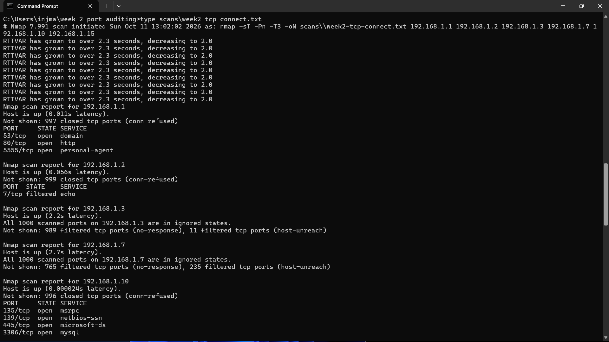
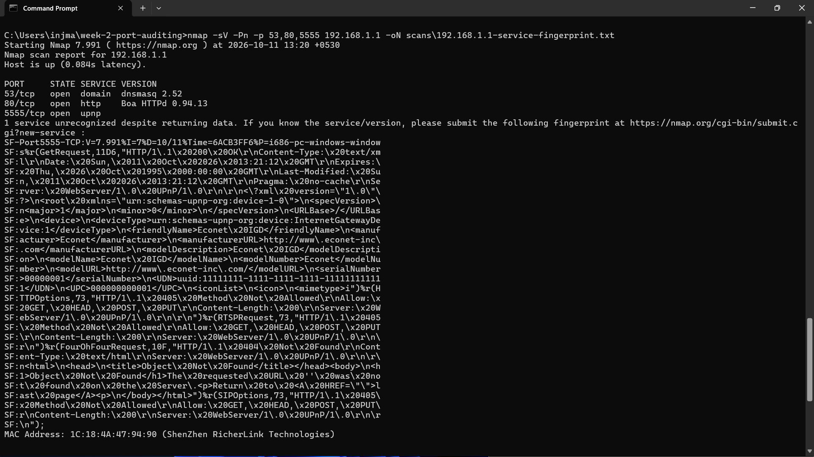
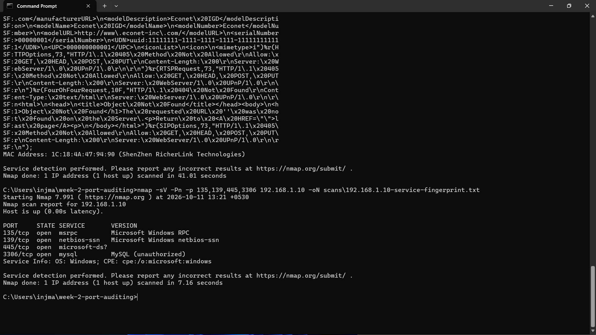
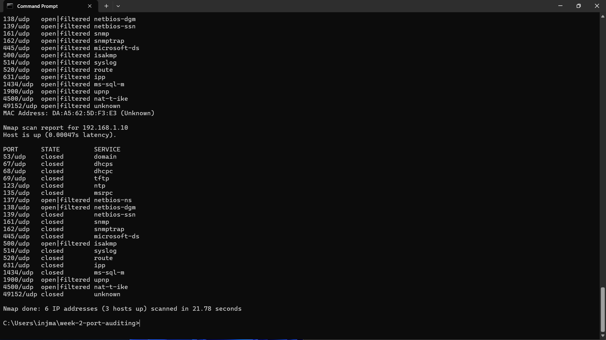
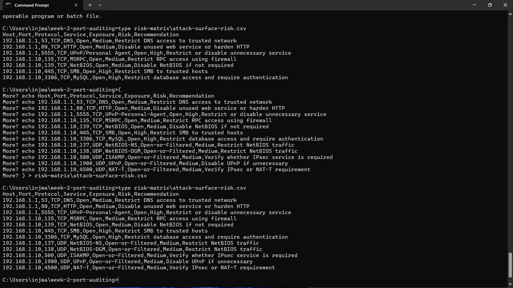

# Week 2 — TCP/UDP Port Audit & Attack Surface Assessment


## Internship

**GetIntern.in — 8-Week Practical Cybersecurity Track**

---

## 1. Objective

The objective of this Week 2 task was to perform an authorized
**TCP and UDP port audit** of the local network using **Nmap**.

The exercise focused on:

- Identifying exposed TCP services
- Performing targeted UDP port scanning
- Performing service fingerprinting
- Understanding open, closed, filtered, and open|filtered states
- Assessing the network attack surface
- Creating a risk classification matrix
- Providing security recommendations
- Maintaining an ethical and authorized testing scope

---

## 2. Tools & Environment

| Category | Details |
|----------|---------|
| Operating System | Windows 11 |
| Command Line | Windows Command Prompt |
| Network Scanner | Nmap 7.99.1 |
| Target Network | `192.168.1.0/24` |
| TCP Scan | TCP Connect Scan |
| UDP Scan | Top 20 UDP Ports |
| Assessment Type | Port Audit + Service Fingerprinting |

---

## 3. Authorized Scope

All scanning activities were performed only against the authorized
local network:

```text
192.168.1.0/24
```

The assessment was limited to previously identified local hosts:

```text
192.168.1.1
192.168.1.2
192.168.1.3
192.168.1.7
192.168.1.10
192.168.1.15
```

No external systems, public IP addresses, or unauthorized networks
were intentionally targeted.

---

## 4. Methodology

The Week 2 assessment was performed in the following stages.

### Step 1 — TCP Port Audit

A TCP connect scan was performed against the previously identified
local hosts.

```bash
nmap -sT -Pn -T3 192.168.1.1 192.168.1.2 192.168.1.3 192.168.1.7 192.168.1.10 192.168.1.15 -oN scans/week2-tcp-connect.txt
```

The `-sT` option performs a TCP connect scan, while `-Pn` skips
host discovery and treats the specified hosts as available for
scanning.

### Step 2 — Service Fingerprinting

Service detection was performed against hosts where open TCP
services were identified.

The scan results were used to identify services and available
service information.

### Step 3 — UDP Port Audit

A targeted UDP scan of the top 20 ports was performed.

```bash
nmap -sU -Pn --top-ports 20 192.168.1.1 192.168.1.2 192.168.1.3 192.168.1.7 192.168.1.10 192.168.1.15 -oN scans/week2-udp.txt
```

The UDP results were reviewed for closed and `open|filtered`
port states.

### Step 4 — Attack Surface Analysis

Observed services were reviewed based on their network exposure
and potential security impact.

### Step 5 — Risk Classification

Identified services were classified as **High** or **Medium** risk
for the purpose of the initial attack-surface assessment.

---

# 5. TCP Port Audit Results

## 5.1 — 192.168.1.1

The host exposed multiple TCP services.

### Open TCP Ports

| Port | State | Service |
|------|-------|---------|
| `53/tcp` | Open | DNS |
| `80/tcp` | Open | HTTP |
| `5555/tcp` | Open | Personal Agent / UPnP-related service |

### Observation

The host exposed DNS, HTTP, and a Personal Agent / UPnP-related
service.

The service fingerprinting results were associated with
**dnsmasq-related** and **Boa HTTPd** services.

No exploitation or authentication attacks were performed.

### Evidence

`scans/192.168.1.1-service-fingerprint.txt`

---

## 5.2 — 192.168.1.2

The TCP audit reported:

| Port | State |
|------|-------|
| `7/tcp` | Filtered |

### Observation

The identified port was filtered and did not provide enough
information to confirm an accessible service.

### Evidence

`scans/week2-tcp-connect.txt`

---

## 5.3 — 192.168.1.3

The TCP audit reported that ports were largely filtered or
provided no response.

### Observation

The results may indicate filtering or firewall behavior.

A filtered result does not confirm that a service is absent; it
indicates that Nmap could not obtain a definitive response from
the scanned port.

### Evidence

`scans/week2-tcp-connect.txt`

---

## 5.4 — 192.168.1.7

The TCP audit reported that ports were largely filtered or
provided no response.

### Observation

No confirmed open TCP service was identified from the scan results.

### Evidence

`scans/week2-tcp-connect.txt`

---

## 5.5 — 192.168.1.10

Multiple TCP services were identified.

### Open TCP Ports

| Port | State | Service |
|------|-------|---------|
| `135/tcp` | Open | MSRPC |
| `139/tcp` | Open | NetBIOS |
| `445/tcp` | Open | SMB |
| `3306/tcp` | Open | MySQL |

### Observation

The host exposed Windows-related network services including
MSRPC, NetBIOS, and SMB.

A MySQL service was also identified on port `3306`.

Authentication status was **not tested**.

No exploitation, credential attacks, or unauthorized access
attempts were performed.

### Evidence

`scans/192.168.1.10-service-fingerprint.txt`

---

## 5.6 — 192.168.1.15

No open TCP ports were identified in the scanned default port set.

### Observation

The absence of an identified open port in this scan does not
necessarily mean that the host has no network services.

### Evidence

`scans/week2-tcp-connect.txt`

---

# 6. Service Fingerprinting Results

Service fingerprinting was performed on hosts where open TCP
services were identified.

## 6.1 — 192.168.1.1

Observed services included:

| Port | Service | Information |
|------|---------|-------------|
| `53/tcp` | DNS | dnsmasq-related service |
| `80/tcp` | HTTP | Boa HTTPd |
| `5555/tcp` | Personal Agent / UPnP | Exact version not conclusively identified |

The fingerprinting results are stored in:

`scans/192.168.1.1-service-fingerprint.txt`

---

## 6.2 — 192.168.1.10

Service fingerprinting identified:

| Port | Service | Information |
|------|---------|-------------|
| `135/tcp` | MSRPC | Microsoft Windows RPC |
| `139/tcp` | NetBIOS-SSN | Microsoft Windows NetBIOS |
| `445/tcp` | Microsoft-DS | SMB-related service |
| `3306/tcp` | MySQL | Authentication not tested |

The host was identified as a Windows system.

The fingerprinting results are stored in:

`scans/192.168.1.10-service-fingerprint.txt`

---

# 7. UDP Port Audit Results

A targeted UDP scan of the top 20 ports was performed.

### Command

```bash
nmap -sU -Pn --top-ports 20 192.168.1.1 192.168.1.2 192.168.1.3 192.168.1.7 192.168.1.10 192.168.1.15 -oN scans/week2-udp.txt
```

### Observed UDP Services

Examples of UDP ports reported during the assessment included:

| Port | Protocol | Service |
|------|----------|---------|
| `137/udp` | UDP | NetBIOS-NS |
| `138/udp` | UDP | NetBIOS-DGM |
| `500/udp` | UDP | ISAKMP |
| `1900/udp` | UDP | UPnP |
| `4500/udp` | UDP | NAT-T |

### Observation

Several UDP ports were reported as **closed** or
**open|filtered**.

An `open|filtered` result means Nmap could not conclusively
determine whether the port was open because UDP services may
not respond directly to the probe.

Therefore, `open|filtered` results should not automatically
be treated as confirmed open services without further validation.

### Evidence

`scans/week2-udp.txt`

---

# 8. Attack Surface Risk Matrix

A risk matrix was created based on the observed network services
and their potential exposure.

| Host | Port | Protocol | Service | Risk | Recommendation |
|------|------|----------|---------|------|----------------|
| `192.168.1.1` | `53` | TCP | DNS | Medium | Restrict DNS access to trusted network |
| `192.168.1.1` | `80` | TCP | HTTP | Medium | Disable unused web service or harden HTTP |
| `192.168.1.1` | `5555` | TCP | UPnP/Personal-Agent | High | Restrict or disable unnecessary service |
| `192.168.1.10` | `135` | TCP | MSRPC | Medium | Restrict RPC access using firewall |
| `192.168.1.10` | `139` | TCP | NetBIOS | Medium | Disable NetBIOS if not required |
| `192.168.1.10` | `445` | TCP | SMB | High | Restrict SMB to trusted hosts |
| `192.168.1.10` | `3306` | TCP | MySQL | High | Restrict database access and require authentication |
| `192.168.1.10` | `137` | UDP | NetBIOS-NS | Medium | Restrict NetBIOS traffic |
| `192.168.1.10` | `138` | UDP | NetBIOS-DGM | Medium | Restrict NetBIOS traffic |
| `192.168.1.10` | `500` | UDP | ISAKMP | Medium | Verify whether IPsec is required |
| `192.168.1.10` | `1900` | UDP | UPnP | Medium | Disable UPnP if unnecessary |
| `192.168.1.10` | `4500` | UDP | NAT-T | Medium | Verify IPsec/NAT-T requirement |

The detailed risk matrix is stored in:

`risk-matrix/attack-surface-risk.csv`

> Note: Risk ratings represent an initial attack-surface assessment
> based on observed network exposure. They do not confirm the presence
> of exploitable vulnerabilities.

---

# 9. Security Observations

The assessment produced the following observations:

1. Multiple TCP services were exposed on `192.168.1.1` and
   `192.168.1.10`.

2. `192.168.1.1` exposed DNS, HTTP, and a UPnP/Personal-Agent-related
   service.

3. `192.168.1.10` exposed MSRPC, NetBIOS, SMB, and MySQL services.

4. Several UDP ports were reported as `open|filtered`, which requires
   further validation before confirming service exposure.

5. SMB on port `445` should be restricted to trusted systems where
   possible.

6. Database services such as MySQL should not be unnecessarily
   exposed to untrusted systems.

7. Legacy services such as NetBIOS should be disabled when they are
   not required.

8. An open or potentially exposed port does not automatically
   indicate a vulnerability.

---

# 10. Security Recommendations

Based on the assessment, the following security controls are
recommended:

1. Restrict management and infrastructure services to trusted hosts.

2. Disable unnecessary services such as unused UPnP or HTTP services.

3. Restrict SMB access using host-based or network firewall rules.

4. Limit MySQL access to systems that require database connectivity.

5. Disable legacy NetBIOS services when they are not required.

6. Review firewall rules for filtered and exposed ports.

7. Keep operating systems and network services updated.

8. Use strong authentication for administrative and database services.

9. Periodically review the network attack surface for newly exposed
   services.

---

# 11. Evidence

All Week 2 evidence files are stored within the project repository.

## TCP Audit

`scans/week2-tcp-connect.txt`

## Service Fingerprinting

`scans/192.168.1.1-service-fingerprint.txt`

`scans/192.168.1.10-service-fingerprint.txt`

## UDP Audit

`scans/week2-udp.txt`

## Risk Matrix

`risk-matrix/attack-surface-risk.csv`

# 12. Screenshots

The following screenshots provide visual evidence of the Week 2
TCP/UDP port auditing, service fingerprinting, and attack-surface
assessment activities.

## 12.1 — TCP Port Audit



---

## 12.2 — Service Fingerprinting: 192.168.1.1



---

## 12.3 — Service Fingerprinting: 192.168.1.10



---

## 12.4 — UDP Port Audit



---

## 12.5 — Attack Surface Risk Matrix



---
---

# 13. Project Structure

```text
week-2-port-auditing/
│
├── README.md
│
├── risk-matrix/
│   └── attack-surface-risk.csv
│
├── scans/
│   ├── 192.168.1.1-service-fingerprint.txt
│   ├── 192.168.1.10-service-fingerprint.txt
│   ├── week2-tcp-connect.txt
│   └── week2-udp.txt
│
└── screenshots/
    ├── 01-tcp-port-audit.png
    ├── 02-service-fingerprinting-192-168-1-1.png
    ├── 03-service-fingerprinting-192-168-1-10.png
    ├── 04-udp-port-audit.png
    └── 05-risk-matrix.png
```

# 14. Limitations

This assessment was intentionally limited to network reconnaissance
and attack-surface analysis.

- The assessment was performed only against the authorized local
  network.
- TCP assessment was based on the performed Nmap scan.
- UDP assessment covered the top 20 UDP ports.
- Service fingerprinting was based on Nmap results.
- `open|filtered` UDP results were not treated as confirmed
  open services.
- No vulnerability exploitation was performed.
- No password or credential attacks were performed.
- No privilege escalation was attempted.
- No denial-of-service testing was performed.
- No unauthorized access was attempted.

Therefore, an exposed port should not automatically be interpreted
as a confirmed vulnerability.

---

# 15. Ethical & Safety Statement

This activity was conducted for cybersecurity learning and
internship practice on an authorized local network.

The assessment was limited to port auditing, service fingerprinting,
and attack-surface analysis.

**No exploitation, password attacks, credential attacks, brute-force
attempts, or unauthorized access were performed.**

The findings are intended for educational, defensive, and
security-awareness purposes.

---

# 16. Skills Demonstrated

Through this exercise, I practiced:

- TCP port auditing
- UDP port auditing
- Network service enumeration
- Nmap service fingerprinting
- Interpretation of open, closed, filtered, and open|filtered states
- Attack-surface assessment
- Security risk classification
- Security recommendations
- Evidence collection
- Technical cybersecurity documentation
- Ethical security testing practices

---

# 17. Conclusion

The Week 2 assessment successfully performed TCP and UDP port
auditing, service fingerprinting, and attack-surface analysis
within the authorized local network.

The exercise provided practical experience in identifying exposed
network services, interpreting Nmap scan results, classifying
potential security risks, and developing appropriate defensive
recommendations.

All assessment activities remained within the defined authorized
scope and no exploitation or unauthorized access was performed.

---

## Week 2 — TCP/UDP Port Audit & Attack Surface Assessment: Completed ✅
